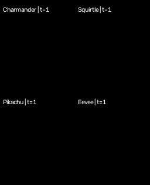
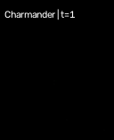
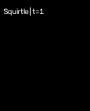
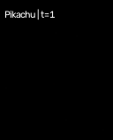
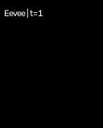

## A Pokédex made of cells

The original NCA experiments in this project grow a 2D image from a small seed.
This experiment gives the automaton a shallow third spatial axis. The visible
image is still one RGBA face of the state, but the other depth slices act as a
local, learnable workspace: a tiny volumetric Pokédex.

The aim is deliberately modest. This is not a 3D mesh generator; it is a
conditional cellular automaton whose local Conv3D rules reconstruct a 2D
Pokémon sprite while maintaining a structured hidden volume.

## Damage recovery looks stronger in 3D

In the current qualitative damage rollouts, increasing the automaton from a
2D lattice to a shallow 3D volume appears to make regeneration from cutouts
faster and more robust. The extra depth gives cells additional local routes to
communicate around damaged regions, rather than relying only on the image
plane. This is an experimental observation from the rollout behaviour, not yet
a controlled speed or robustness benchmark.

:::{.callout-note}
The code and training configuration live in the
[NCA repository](https://github.com/howaboutyu/NCA). The multi-Pokémon examples
below are the latest available validation rollout for each identity from the
five-target 64×64 run. Validation rotates identities every 500 optimizer steps,
so the source checkpoints span steps 95,500–98,000 rather than pretending that
all four panels came from one checkpoint.
:::

## The cellular state

Each batch item is a channel-first volume:

$$
s \in \mathbb{R}^{B \times C \times D \times H \times W}.
$$

The first three channels are RGB, the fourth is alpha/liveness, and the
remaining channels are hidden state. In the main run, $D=8$ and $C=32$. A
selected $z=0$ depth slice is supervised against the target RGBA sprite; the
other slices are free to participate in local communication.

## A learned local rule

At each step, a zero-padded $3\times3\times3$ convolution lets each cell read
its immediate volumetric neighbourhood. Pointwise $1\times1\times1$ layers
convert that perception into a residual state update:

$$
s_{t+1} = s_t + m_t \odot \Delta_\theta(P_{3D}(s_t)).
$$

Here $m_t$ is a stochastic update mask. The final update layer starts at zero,
so the initial automaton is an identity rule rather than a random explosion.
An alpha-neighbourhood mask removes cells disconnected from the living
structure.

## Conditioning on Pokémon identity

For this multi-sprite run, channels 4–8 receive a one-hot Pokémon identity only
in the living cells of a fresh seed at $t=0$. No external identity vector is
re-injected during later cellular updates. The recurrent rule must preserve
and propagate that initial information through its own state—a small test of
whether the automaton can learn from history rather than from a static label.

The selected face is trained with ordinary mean-squared error over all four
RGBA channels, matching the original 2D objective used by this project:

$$
L_{RGBA} = \operatorname{mean}\!\left[(\operatorname{clip}(\hat y,0,1)-y)^2\right].
$$

## Latest multi-Pokémon rollouts

Each panel starts from a seed carrying a different one-time identity and runs
the same learned local rule. The timeline includes scheduled cutouts, so the
animation shows both growth and qualitative recovery. The panels are aligned
by rollout time; exact source steps are recorded in `gifs/sources.tsv`.

  

### Individual rollouts

:::{.pokemon-grid}
<figure>
  
  <figcaption>Charmander</figcaption>
</figure>

<figure>
  
  <figcaption>Squirtle</figcaption>
</figure>

<figure>
  
  <figcaption>Pikachu</figcaption>
</figure>

<figure>
  
  <figcaption>Eevee</figcaption>
</figure>
:::

The reconstructions are recognizable and stable, but this remains qualitative
evidence. The validation sequence is useful for inspecting growth and recovery;
it is not yet a controlled comparison against an otherwise identical 2D model.

## Where to take it next

The current system is best understood as a working 3D local-rule baseline.
Promising next steps are longer rollouts, a small consistency loss across
neighbouring depth slices, and an explicit regularizer for off-target living
volume. Those should be evaluated against the selected-face reconstruction,
rather than treating a prettier voxel rendering alone as a win.
