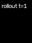
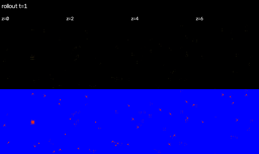
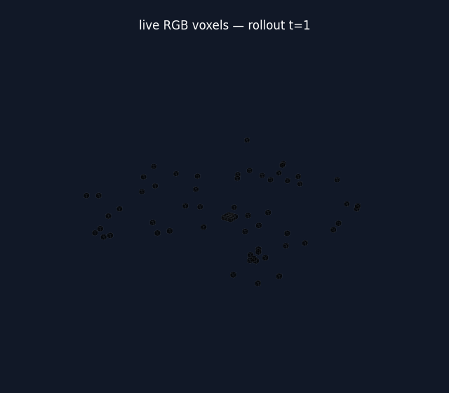

## A Pokédex made of cells

The original NCA experiments in this project grow a 2D image from a small seed.
This experiment gives the automaton a shallow third spatial axis. The visible
image is still one RGBA face of the state, but the other depth slices act as a
local, learnable workspace: a tiny volumetric Pokédex.

The aim is deliberately modest. This is not a 3D mesh generator; it is a
conditional cellular automaton whose local Conv3D rules reconstruct a 2D
Pokémon sprite while maintaining a structured hidden volume.

:::{.callout-note}
The code and training configuration live in the
[NCA repository](https://github.com/howaboutyu/NCA). The examples below are
from validation at training step 59,500 of the 64×64 experiment.
:::

## The cellular state

Each batch item is a channel-first volume:

$$
s \in \mathbb{R}^{B \times C \times D \times H \times W}.
$$

The first three channels are RGB, the fourth is alpha/liveness, and the
remaining channels are hidden state. In the main run, $D=8$ and $C=32$. A
single middle depth slice is supervised against the target RGBA sprite; the
other slices are free to participate in local communication.

## A learned local rule

At each step, a zero-padded $3\times3\times3$ convolution lets each cell read
its immediate volumetric neighbourhood. Pointwise $1\times1\times1$ layers
convert that perception into a residual state update:

$$
s_{t+1} = s_t + m_t \odot \Delta_\theta(P_{3D}(s_t)).
$$

Here $m_t$ is a stochastic update mask. The final update layer starts at zero,
so the initial automaton is an identity rule rather than a random explosion.
An alpha-neighbourhood mask removes cells disconnected from the living
structure.

## Conditioning on Pokémon identity

For the multi-sprite variant, each Pokémon ID maps to a learned embedding. The
embedding is broadcast through the volume and concatenated to the Conv3D
features before the local update network. That means the rule can stay local
while still knowing which sprite it is trying to grow.

The training loss emphasizes foreground pixels so transparent background does
not dominate reconstruction:

$$
L_{fg} = \frac{\operatorname{mean}(w \odot (\hat y-y)^2)}
              {\operatorname{mean}(w)},
\qquad
w = 1 + (\lambda_{fg}-1)y_\alpha.
$$

## What it looks like at step 59,500

The selected face is already recognizable. The depth and voxel views are more
revealing: the automaton has organized activity through the volume, but the
reconstruction still carries visible lattice noise. Making those hidden slices
cleaner without collapsing the useful communication path is the next problem.

### Selected reconstructed face

### All depth slices

### RGB voxel preview

## Where to take it next

The current system is best understood as a working 3D local-rule baseline.
Promising next steps are longer rollouts, a small consistency loss across
neighbouring depth slices, and an explicit regularizer for off-target living
volume. Those should be evaluated against the selected-face reconstruction,
rather than treating a prettier voxel rendering alone as a win.
